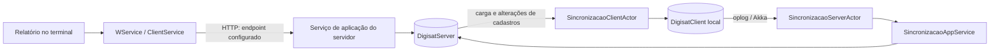

# Sincronização e divergência do mensal — investigação de 30/10/2026

**Resultado:** foi identificado no build instalado um defeito de concorrência na soma mensal por vendedor. O padrão foi reproduzido com entrada fixa, sem SuiteG6 nem MongoDB: 39/40 execuções divergiram. A correção que publica um novo array, sem modificar o valor compartilhado, acertou 40/40. Isso torna o cálculo uma linha prioritária de investigação; ainda não comprova a causa dos relatórios do cliente, cujos anexos, binários e endpoints não foram recebidos nesta etapa.

**Solução proposta:** corrigir e homologar a redução paralela no código original; confirmar versão, endpoint e empresa de cada máquina; repetir os relatórios sobre dados estáveis. Repetir a sincronização não corrige esse defeito de cálculo. Nenhum binário DigiSat, serviço, checkpoint ou registro de produção foi alterado.

**Atualização de 30/10/2026 — anexos recebidos:** os três relatórios "Movimentações por mês" de 28/10/2026 encaixam no padrão descrito aqui. São 9 células divergentes em 60, todas menores que o maior valor observado, em meses e máquinas diferentes, com o relatório do SERVIDOR abaixo dos terminais em julho e agosto. O total consolidado é R$ 1.679.455,08, contra R$ 1.675.291,56 no SERVIDOR. Comparação completa em [analise-relatorios-mes-2026-10-28.md](analise-relatorios-mes-2026-10-28.md).

## Escopo e identidade

Análise estática com REA 6.7.0 e reconstrução complementar com dnSpy.Console. A extração não carrega nem executa código SuiteG6. O build local atual dos componentes principais é **2.0.26300.5**, diferente da referência histórica 2.0.26273.6; o padrão inseguro foi reconferido no build atual.

- `DigisatServer.Application.Main.dll`: SHA-256 `471908afa8e8ae43aaab13722e7820006c4b7a221600983abc42e9c3b9039af4`; MVID `9d61d9ad-dcf5-4dea-9058-df2fda5d7d38`. As cópias locais em Sistema e Servidor têm esse mesmo hash.
- `SincronizadorG6.exe`: SHA-256 `55121ea61548d948ac562b9be0729d3b6e4ba72f48da44f1b43d9ee7487d6d14`; MVID `e2a1aba1-6497-494f-b1fc-18fcf49c8996`.
- `DigisatServer.Infrastructure.Data.Core.dll`: SHA-256 `c848fb91ea7394a94e9302645fdcb19022efdd8de12a7257179794ecb1f485d8`; MVID `6ed13566-e1a8-4865-b36b-aafe253f5f11`.

Fontes reconstruídas, hashes e resultados ficam em [engenharia/sincronizacao-2026-10-30](../engenharia/sincronizacao-2026-10-30/). O bundle REA completo é um artefato local de investigação; os C# são reconstruções, não o código-fonte original. Metadados e CIL são observações canônicas; a interpretação do comportamento é inferência estática. As strings de alguns membros têm avisos de formato no heap `#US`; esses avisos não foram tratados como validação do runtime.

## O mensal e a sincronização usam caminhos distintos



O desenho representa a implementação encontrada, não uma captura da rede do cliente. O sincronizador monta o destino Akka com IP da configuração e porta **12222**. O cliente de relatórios monta `http://{endpoint}/{contrato}`; a configuração recuperada define **12221 como porta padrão**, que precisa ser confirmada na instalação. MongoDB local do sincronizador é configurado em **12220**.

O registro DI em `Bootstrapper` associa `IWService` a `WService`. Este cria `ClientService(configuracaoClient.EndPoint)` e encaminha `Canal<TContract,TResult>` ao proxy. `ClientService` mantém canais por contrato; não resultados mensais. Existe uma verificação de disponibilidade com tratamento de PDV offline, mas ela não substitui a consulta mensal por dados locais nesse caminho. O mensal chama o serviço para gerar os dados; a ponte WCF inclui a empresa da identidade do usuário.

Evidência atual: [Bootstrapper](../engenharia/sincronizacao-2026-10-30/fontes-cliente/Bootstrapper.instalado.cs), [WService](../engenharia/sincronizacao-2026-10-30/fontes-cliente/WService.instalado.cs), [ClientService](../engenharia/sincronizacao-2026-10-30/fontes-cliente/ClientService.instalado.cs) e [manifesto de identidade](../engenharia/sincronizacao-2026-10-30/fontes-cliente/manifesto-cliente.json). Endpoint e empresa efetivamente usados pelo cliente continuam por verificar.

## O que a sincronização faz

| Caminho | Dados e comportamento encontrados | Implicação |
| --- | --- | --- |
| Terminal → servidor | O sincronizador lê o oplog de `DigisatClient` e encaminha `Movimentacoes`, `RegistrosPafEcf`, `TransacoesPbm` e `LastTs`. | Pode entregar movimentações antigas que ainda não tenham chegado ao servidor; não há filtro por mês de emissão nesse encaminhamento. |
| Recepção de movimentações | Se o ID não existe, o serviço efetiva/cancela conforme o estado recebido e adiciona o documento. Se já existe, o ramo visível trata Concluído → Cancelado; não substitui genericamente os itens de qualquer documento existente. | Uma chegada tardia ou cancelamento de documento antigo pode afetar um mês anterior. Isso não prova que ocorreu no cliente. |
| Servidor → terminal | A lista inclui usuários, perfis, configurações, pessoas, produtos, preços, operações fiscais, pagamentos e outros cadastros. **Movimentacoes não integra essa lista.** | A carga completa encontrada não é uma cópia bidirecional de todo o histórico de vendas. |
| Reconexão | Se o servidor ainda conhece o instante de desconexão, reenvia o intervalo do oplog; senão envia carga de cadastros. O instante offline recebe uma sobreposição de cinco minutos. | “Reconectado” e “carga concluída” não demonstram igualdade documental entre bases. |
| Checkpoint/erros | O encaminhamento por ator usa `Tell` e atualiza `LastTs` no emissor; não há ACK de persistência por documento nessa rotina. `ReplaceOne` do serviço registra exceções sem propagá-las; `Sincronizar` tem tratamento diferente e propaga erro. | A ausência de erro visível na tela não é prova de entrega de todos os registros. Não foi demonstrada perda real nesta instalação. |

Fontes atuais: [ator cliente](../engenharia/sincronizacao-2026-10-30/fontes/SincronizacaoClientActor.cs), [ator servidor](../engenharia/sincronizacao-2026-10-30/fontes/SincronizacaoServerActor.cs), [replicador](../engenharia/sincronizacao-2026-10-30/fontes/CollectionReplicator.cs), [oplog](../engenharia/sincronizacao-2026-10-30/fontes/OpLogTail.cs), [repositório](../engenharia/sincronizacao-2026-10-30/fontes/RepositorySincronizacao.cs) e [serviço receptor](../engenharia/sincronizacao-2026-10-30/fontes/SincronizacaoAppService.cs).

Não apagar `LastTs`, coleções ou dados locais para tentar reparar o problema: a implementação contém gravações, cargas e limpezas de cadastros. Uma eventual recuperação de sincronização precisa preservar os dados pendentes e ser definida a partir dos documentos efetivamente ausentes. Não foi rastreado qual botão/menu exato Giovani utilizou; ele pode acionar uma rotina diferente da carga analisada.

## Defeito no cálculo mensal

`ObterTotalMovimentacoesPorMesPorVendedor` consulta páginas de 500 movimentações, acumula valores por vendedor/mês em dicionários locais e mescla as partições com `Parallel.ForEach`. O grau é `Math.Max(2, Environment.ProcessorCount / 2)`, referente ao processo que executa o cálculo, e não automaticamente à CPU do terminal que pediu o relatório.

O merge encontrado é:

```csharp
acumuladoGlobal.AddOrUpdate(chave, parcial, (key, existing) => {
    for (int i = 0; i < 12; i++)
        existing[i] += parcial[i];
    return existing;
});
```

O dicionário concorrente protege suas operações, mas não torna atômica a modificação dos elementos de um array compartilhado. Duas partições podem ler o mesmo valor e uma sobrescrever a soma da outra. O banco não precisa mudar para o resultado mudar; os meses afetados dependem do intercalamento das tarefas.

O método exato do merge no binário instalado tem token **0x0600328a**, no fechamento gerado para o mensal. Hash CIL normalizado **eb8ff402138693715a1af3ab25f4166aaf48f50ded5553a1ab767e0b8ae0f74e**. A reconstrução por token está em [merge-mensal-0x0600328a.cs](../engenharia/sincronizacao-2026-10-30/fontes/merge-mensal-0x0600328a.cs), com [vínculo de identidade](../engenharia/sincronizacao-2026-10-30/manifesto-merge-mensal.json). Tokens são locais a esse hash/MVID.

### Reprodução e correção

Entrada sintética fixa: 60.000 documentos, páginas de 500, um vendedor, 12 meses, R$ 1,01 por documento. Ambiente .NET Framework, seis CPUs, grau três. Nenhuma DLL DigiSat, rede, MongoDB ou dado de cliente foi usado.

| Variante | Execuções corretas | Total anual esperado | Total anual observado |
| --- | --- | --- | --- |
| Controle sequencial | 3/3 | R$ 60.600,00 | R$ 60.600,00 |
| Merge compartilhado recuperado | 1/40 | R$ 60.600,00 | R$ 59.550,61 a R$ 60.600,00 |
| Merge com novo array | 40/40 | R$ 60.600,00 | R$ 60.600,00 |

As rodadas naturais não têm barreiras nem pausas artificiais. Há uma prova separada, explicitamente instrumentada, para mostrar uma soma perdida; ela não integra o resultado 39/40. Uma rodada correta por acaso não demonstra segurança do padrão mutável.

Correção demonstrada para integração no código original:

```csharp
acumuladoGlobal.AddOrUpdate(chave, parcial, (key, existing) => {
    var novo = new decimal[12];
    for (int i = 0; i < 12; i++)
        novo[i] = existing[i] + parcial[i];
    return novo;
});
```

Após publicar um array no dicionário, nenhum consumidor deve modificá-lo. O callback fica sem efeitos colaterais e publica outra referência. Outra solução é guardar as partições e reduzi-las sequencialmente depois do trabalho paralelo. Apenas trocar o número de threads ou refazer sincronização não é a correção definitiva.

[Fonte do ensaio](../engenharia/sincronizacao-2026-10-30/repro-monthly-array-race.cs), [resultado JSON](../engenharia/sincronizacao-2026-10-30/resultado-repro-monthly.json) e [instruções de reprodução](../engenharia/sincronizacao-2026-10-30/resultado-repro-monthly.txt). A prova cobre o padrão de agregação; não reproduz filtros, paginação de dados reais, renderização ou o ambiente do cliente. Nenhum patch foi aplicado aos binários instalados.

## Procedimento para fechar o caso de Giovani

1. **Preservar os relatórios e identificar o ambiente.** Coletar servidor e terminais, empresa/usuário efetivos, parâmetros completos, versões/hashes e destino real da consulta. Não presumir que o relatório “SERVIDOR” ou o maior total está correto.
2. **Testar repetibilidade.** Em uma cópia estável da base, gerar dez vezes o mesmo relatório anual por vendedor, com o mesmo endpoint, empresa e filtros, comparando os meses anteriores a outubro. Repetir no servidor e em um terminal. Se variar na mesma máquina sem mudança de entrada, diferenças entre cópias sincronizadas deixam de ser necessárias para explicar o sintoma.
3. **Reconciliar os documentos/itens.** Calcular serialmente o total com os filtros exatos do mensal: empresa, emissão, situação, origem, finalidade, vendedor e regras de cancelamento/operação fiscal. Não usar CPF/total integral de documentos como substituto do total de itens do vendedor.
4. **Integrar a correção no fonte oficial.** Confirmar a mesma implementação na versão do cliente, remover o merge mutável, revisar os outros totalizadores que usam o padrão e gerar um build de suporte. A homologação deve repetir valores exatos por vendedor/mês, acima de 500 documentos, em graus 1, 2, 3 e 8, com entrada congelada e referências seriais. Homologar também descontos, cancelamentos e documentos com vários vendedores.
5. **Investigar sincronização somente com evidência documental.** Se houver IDs ausentes entre terminal e servidor, conferir o histórico local, checkpoints e erros de persistência antes de definir reenvio. Se documentos e itens forem iguais e só o relatório variar, corrigir a consulta/cálculo; não reparar dados corretos para fazer um relatório defeituoso coincidir.

Coletor entregue, sem executar relatórios, sincronização ou controle de serviços:

```powershell
powershell.exe -NoProfile -ExecutionPolicy Bypass -File .\engenharia\ferramentas\coletar_sincronizacao.ps1 -Identificacao SERVIDOR -OutputDirectory .\diagnostico
```

Nos terminais, trocar a identificação. O script inventaria hashes/versões, estado dos serviços, processos, conexões existentes nas portas conhecidas e campos IP/porta permitidos de configuração. Não inclui senhas, configuração bruta ou documentos de venda. Ele só escreve o JSON na pasta indicada; não abre conexões de teste nem altera a aplicação. Campo configurado e snapshot TCP não provam, sozinhos, o destino de uma solicitação específica.

O coletor foi executado nesta máquina e o JSON foi validado estruturalmente. Não demonstra a configuração do cliente remoto. A [ferramenta de extração estática](../engenharia/ferramentas/rastrear_sincronizacao.py) permite refazer as reconstruções por tipo e preserva hashes.

## Evidências REA e pendências

| Registro | Conteúdo |
| --- | --- |
| `ev_ef7248082602773024cc9d546c9fff7f1479d06ca848acbbea7c9ce057d90b96` | OpLogTail, CollectionReplicator e RepositorySincronizacao: metadados/CIL |
| `ev_71f65185ce2dd87514a37e771c826221e665f3bfaa95a6a4216ead9ba6daf1c3` | SincronizadorG6: tipos e chamadas |
| `ev_94afb4f076ff5c19120da671107ccdf8a3e027431b9c35a3c90fe276a471d449` | Atores de sincronização do servidor |
| `ev_4bebca524696e7614104ca85c27f4d6f17029189ae5a8ffc93d28d4c4f5ab2b3` | Serviço de relatórios instalado |
| `ev_970c4da1f02ae671181a8e2bb358ad62035df7730a1f6879771004ac3d39f91f` | Fechamentos e máquina de estados do mensal; inclui nomes de tipos gerados repetidos, desambiguados por tokens |
| `ev_f0a69eabd426b911bbf95343232905e6d477858db895739cd46e01d3732d7f8d` | WService atual |
| `ev_1d41d91332c4987533a4556489f847cf259667b2b8e14e2d5d5cef08ea57e532` | Registro DI atual |
| `ev_8effc0355caf1b8951786f81f8ee0b72ab3ccb5bd2b98a297f50593e46f2e1a2` | ClientService atual |

Checklist: mecanismo cliente/servidor **respondido estaticamente**; caminho do relatório **respondido estaticamente**; candidato de concorrência **confirmado no build local e reproduzido no padrão**; causa dos PDFs do cliente **não confirmada**; botão de sincronização utilizado **não identificado**; implantação da correção oficial **pendente de fonte/build e homologação**.
