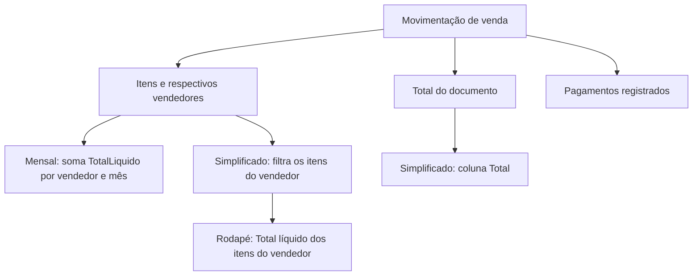

# Como o Digisat calcula estes relatórios

Este guia acompanha a resposta ao e-mail sobre vendas por mês, movimentação simplificada e a diferença de 05/10/2026 da Vendedora 2. A explicação separa valor do documento, valor dos itens do vendedor e pagamentos: são informações relacionadas, mas calculadas por caminhos diferentes.

Revisão: 26/10/2026. A consulta de 05/10 foi executada novamente nesta revisão e reproduziu os valores abaixo. Os números de setembro e as evidências da fórmula provêm da análise registrada em 23/10; não foram todos recalculados nesta revisão.

## 1. O que cada informação representa

| Informação | Origem | Pergunta que responde |
|---|---|---|
| Total do documento | `movimentacao.Total` | Qual é o valor da venda inteira? |
| Total dos itens do vendedor | Soma de `item.TotalLiquido` dos itens atribuídos ao vendedor | Quanto dos itens vendidos pertence a este vendedor? |
| Pagamentos registrados | `ItensPagamentos` | Como o documento foi pago? |
| Valor recebido após taxas | Não é o cálculo do mensal analisado | Quanto efetivamente foi recebido na liquidação financeira? |

Uma venda pode ter um CPF, dois vendedores e pagamento integral em cartão. Selecionar um vendedor não transforma automaticamente o total dessa venda no total dos itens dele.



## 2. Caminho do relatório mensal

O método `ObterTotalMovimentacoesPorMesPorVendedor` recebe ano, origem, situação, vendedor e empresa. Portanto, NFC-e/Concluído é o recorte usado nesta investigação, não uma condição fixa de todo uso possível do relatório.

Na descompilação preservada, o método:

1. Seleciona movimentações ativas da empresa, no ano pela data de emissão, com a origem e situação recebidas, finalidade normal e a exclusão de NFC-e de movimentação de item financeiro.
2. Desconsidera itens cancelados. Para itens de documento auxiliar, exige operação fiscal que movimente estoque e financeiro.
3. Obtém o vendedor de cada item (`VendedorReferencia`). Se há vendedor selecionado, acumula somente os itens dele.
4. Usa o mês de `DataHoraEmissao` e soma `item.TotalLiquido` naquele vendedor/mês.

Trecho central, reduzido para facilitar a leitura:

```csharp
// Depois dos filtros de movimentação e item:
string vendedor = item.VendedorReferencia.ToStringEmptyWhenDefault();
int mes = movimentacao.DataHoraEmissao.Month;
acumulado[vendedor][mes - 1] += item.TotalLiquido;
```

O acumulador não subtrai pagamentos, parcelas ou taxas de cartão. O valor é atribuído ao mês da venda por emissão, não distribuído pelos vencimentos das parcelas.

Fonte: [método mensal, linha 148](../engenharia/fontes-recuperados/2.0.26273.6/MovimentacaoSaidaRelatorioAppService.dnspy.cs#L148), especialmente o filtro dos itens e a soma na linha 202. Os fragmentos acima são explicativos, não uma transcrição integral.

### O significado de “líquido” no item

```text
TotalBruto = arredondar(preço unitário × quantidade, 2 casas)
TotalLiquido = TotalBruto
             − DescontoDigitado − DescontoProporcional
             + OutrasDespesasProporcional + OutrasDespesasDigitado
             + ST + IPI + Frete + Seguro
```

Assim, “líquido” aqui significa após os ajustes do item. Uma venda de R$ 100,00 sem ajustes, paga em cartão, contribui com R$ 100,00 para o mensal. A forma de pagamento não reduz esse valor. Com R$ 10,00 de desconto e nenhum acréscimo, contribui com R$ 90,00, mesmo paga no cartão.

Isso permite conferir a base de comissão: o relatório considera os descontos e também os acréscimos da fórmula. A adequação à política de comissão depende do que a empresa remunera.

A fórmula e o arredondamento foram documentados para o build **2.0.26293.5**, com hashes e referência dos métodos, em [Fórmula do faturamento](continuacao-formula-faturamento.md). A auditoria anterior encontrou zero divergências de bruto nos 152.034 itens e zero divergências de líquido acima de R$ 0,005. É uma verificação desta base, não prova para qualquer dado possível.

### Conferência pelo cartão em setembro

No recorte NFC-e/Concluído utilizado na análise anterior:

| Medida | Valor |
|---|---:|
| Total dos itens | R$ 170.356,74 |
| Pagamentos registrados | R$ 170.356,74 |
| Parcela desses pagamentos classificada como cartão POS | R$ 111.806,62 |
| Total hipotético se o cartão POS fosse excluído | R$ 58.550,12 |

A conclusão de que o cartão entra vem do caminho do cálculo; a conciliação numérica serve como confirmação independente. Os pagamentos registrados não demonstram, por si só, a liquidação bancária após taxas.

## 3. Caminho da movimentação simplificada

A projeção que prepara os dados do relatório mantém simultaneamente:

```csharp
dto.Total = movimentacao.Total;
dto.Itens = movimentacao.Itens
    .ProjectedAsCollectionItemRelatorioBaseDto(vendedorReferencia, ...);
```

Quando existe vendedor selecionado, a segunda operação filtra os itens por `VendedorReferencia`. Ela não recalcula `dto.Total` para conter apenas esses itens.

Isso chega ao layout de duas maneiras verificáveis:

- A coluna **Total** está vinculada ao campo `Total` do documento.
- O rodapé soma `x.Itens.Sum(y => y.TotalLiquido)` e recebe o título **“Total líquido dos itens do vendedor:”** quando há vendedor selecionado.

Referências preservadas:

- [MovimentacaoProjection.cs](../engenharia/assemblies-descompilados/2.0.26273.6/DigisatServer.Application.Core/DigisatServer.Application.Core/Projections/MovimentacoesProjection/MovimentacaoProjection.cs): linha 996 (`Total`), linha 1148 (projeção de `Itens`) e linhas 1196–1205 (filtro por vendedor).
- [Layout do simplificado](../engenharia/codigo-descompilado/Modulo.Relatorios/Reports/Movimentacao/ListaMovimentacoesPorOrigemETipoSimplificado.Designer.cs): linhas 314–315 (título e soma do rodapé), linha 426 (coluna vinculada a `Total`).

Portanto, a diferença identificada nas vendas por CPF destes documentos é uma diferença de abrangência dos campos. Não foi identificada uma dedução de cartão. A evidência trata desse layout e desse caso; não demonstra que toda tela ou relatório do sistema chamado “vendas por CPF” use a mesma regra.

## 4. Prova numérica: 05/10/2026, Vendedora 2

| Documento | Hora | Venda inteira | Itens V2 | Itens V4 | Pago em cartão |
|---|---|---:|---:|---:|---:|
| 001/217242 | 10:29 | R$ 119,96 | R$ 54,98 | R$ 64,98 | R$ 119,96 |
| 001/217322 | 16:19 | R$ 113,92 | R$ 73,94 | R$ 39,98 | R$ 113,92 |
| Soma destes dois documentos | | R$ 233,88 | R$ 128,92 | R$ 104,96 | R$ 233,88 |

No primeiro documento, a V2 tem CAL. SANDRA (R$ 24,99) e CALCINHA ALTA LATERAL (R$ 29,99). A V4 tem MEIA SAPATILHA (R$ 24,99) e MEIA LUPO KIT3 (R$ 39,99).

No segundo, a V2 tem 4 × MEIA CAL. CLAS. de R$ 14,99 e 2 × SAPATILHA FIO de R$ 6,99, totalizando R$ 73,94. A V4 tem 2 × TANGA SUELANE de R$ 19,99, totalizando R$ 39,98.

Considerando **todos os documentos do dia que contêm itens da V2**:

```text
Documentos inteiros:           R$ 2.145,11
Itens exclusivos da V2:      − R$ 2.040,15
Diferença:                    R$   104,96
Itens da V4 nos dois casos:    R$    64,98 + R$ 39,98 = R$ 104,96
```

Os R$ 233,88 da tabela são só os dois documentos compartilhados; os R$ 2.145,11 abrangem todos os documentos do dia com a V2. A diferença fecha sem deduzir cartão, taxas ou parcelas.

## 5. Como reproduzir e conferir

Na raiz do projeto, a ferramenta existente faz consultas de leitura usando a conexão configurada para o painel:

```powershell
# Entender os parâmetros sem consultar o banco:
.\.venv\Scripts\python.exe engenharia/ferramentas/diagnostico_relatorios.py --explain

# Conferir os documentos compartilhados e o total do dia:
.\.venv\Scripts\python.exe engenharia/ferramentas/diagnostico_relatorios.py --date 2026-10-05 --seller-ref 6496ee283a5e352378b9e8f1

# Reproduzir o mensal no recorte NFC-e/Concluído/finalidade normal:
.\.venv\Scripts\python.exe engenharia/ferramentas/diagnostico_relatorios.py --year 2026 --company "NOME EXATO DA EMPRESA"
```

Substitua o nome da empresa pelo valor de `Empresa.Nome`. Sem `--company`, a ferramenta soma todas as empresas disponíveis. A consulta usa a base configurada no ambiente; mudar a base pode mudar os resultados.

Saída confirmada em 26/10, valores em reais:

```text
001/217242  documento 119.96  VENDEDORA 2 54.98  outros 64.98  pago 119.96
001/217322  documento 113.92  VENDEDORA 2 73.94  outros 39.98  pago 113.92
Total of documents containing VENDEDORA 2: 2145.11;
VENDEDORA 2: 2040.15; difference: 104.96
```

**Limitação relevante da ferramenta:** na consulta de compartilhados, a coluna `documento` é reconstruída somando os itens não cancelados; ela não lê diretamente a propriedade de domínio `movimentacao.Total`. O comando mensal aplica finalidade normal; a consulta de compartilhados não aplica esse filtro. Portanto, a ferramenta reproduz a aritmética deste caso, mas não substitui a conferência dos filtros e do total no relatório nativo. Fonte: [diagnostico_relatorios.py](../engenharia/ferramentas/diagnostico_relatorios.py), funções `monthly_by_seller` e `shared_documents`.

Para conferir na interface do Digisat:

1. Abra os documentos 001/217242 e 001/217322 e confira os vendedores por item e os pagamentos.
2. Gere a movimentação simplificada para 05/10/2026, com Vendedora 2 e o mesmo recorte de empresa/origem/situação/finalidade.
3. Compare o total integral dos documentos com o rodapé **“Total líquido dos itens do vendedor”**. Procure os R$ 104,96 nos itens da V4.
4. Para comparar com o mensal, use o mesmo período e escopo e compare os valores dos itens da V2. O mensal é por mês; seu valor de outubro não deve ser comparado diretamente ao valor de um único dia.
5. Para a conferência global usada no processo do Sintegra, retire o filtro de vendedor e alinhe os documentos e demais filtros. A equivalência fiscal com o arquivo Sintegra exige verificar também suas regras e registros; não foi demonstrada nesta análise.

## 6. Alcance da conclusão

As regras do mensal e da projeção do simplificado foram lidas em C# descompilado preservado da versão **2.0.26273.6**. A fórmula do item tem evidência adicional do build **2.0.26293.5**. Isso não comprova que todo o caminho dos dois relatórios seja idêntico entre versões. Não houve nova execução dos assemblies ou observação da interface nesta revisão; a confirmação nova foi a consulta de leitura de 05/10.

As evidências históricas disponíveis descrevem o corte da base em 20/10/2026, mas divergem ao afirmar sua identidade exata com o ZIP enviado. Por isso, este guia se refere à **base configurada consultada**, sem afirmar igualdade binária com o backup. Para auditoria formal, registre a identificação/hash do backup e os parâmetros dos relatórios.

As diferenças entre gerações antigas de abril/setembro são outra investigação. Elas não são necessárias para explicar as três dúvidas do e-mail e não têm sua causa demonstrada por este caso.
